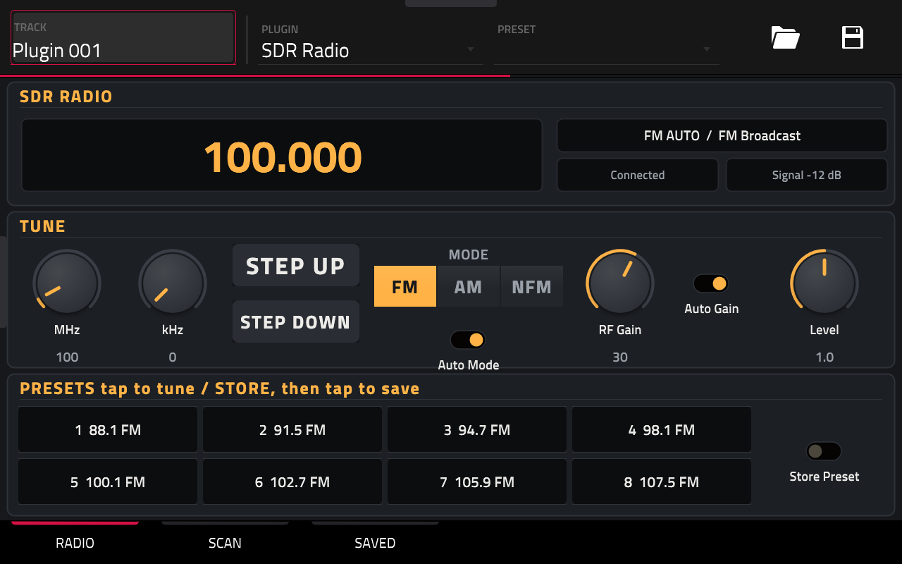

# SDR Radio for MPC

Live radio from an RTL-SDR dongle, as a native plugin for Akai's standalone
MPCs: FM, AM and narrow FM, station presets, and scanning that lands on the
beat. Plug a dongle into the MPC's USB port, add **SDR Radio** to a track, and
play the airwaves like an instrument.



- **Tune** with the MHz / kHz knobs or the step buttons (the right channel
  spacing for each mode). **Auto Mode** picks FM, AM or narrow FM from the
  frequency.
- **Eight presets**: tap to tune; light **Store** and tap to save. MPC pads
  1-8 recall them.
- **Scan** 14 bands (FM, AM, air, NOAA weather, marine, rail, emergency VHF
  and UHF, GMRS, ham 2 m and 70 cm, CB, shortwave night and day), on the beat
  (locked to the MPC's sequencer) or by squelch, like a scanner.
- **Saved, Blocked, New**: when a scan stops, **Keep** the channel or
  **Block** it for good. Scan only what you saved, only what's new, or both.
  **Find Active** checks every new channel once and saves the active ones.
  Saved and blocked channels are shared by every project.

## You need

- A first-generation standalone MPC or Force (MPC Live, Live II, One, X,
  Key 61, Force: 32-bit ARM), MPC OS 2.x or 3.x. Gen2 models (Live III, One G2,
  Key G2) aren't supported yet.
- An RTL-SDR dongle. The RTL-SDR Blog V4 also receives AM broadcast and
  shortwave (it has a built-in upconverter); other dongles start at about
  24 MHz. Some dongles draw more power than an MPC port likes: a powered hub
  helps.
- A way to install plugins on the MPC: the Open MPC plugin installer or
  catalog (<https://sd88me.github.io/mpc-vst-plugins/>), which need root SSH
  or the plugin-manager USB stick.

When you plug the dongle in, MPC shows "USB device not supported". That's
MPC itself, which has no use for a radio; the plugin opens the dongle
directly. Ignore it.

## Install

From the Open MPC catalog or installer app: pick **SDR Radio**. Or by hand,
over SSH, from a release zip:

```
unzip SDR-Radio-<version>-mpc-armv7.zip
scp -r SDR-Radio-<version> root@<mpc-ip>:/tmp/
ssh root@<mpc-ip> sh /tmp/SDR-Radio-<version>/install.sh -t <Synths folder>
```

The Synths folder is on the internal drive: `/sdcard/Synths` on most units,
`/storage/Synths` on an MPC One. Installing restarts MPC once: save your
project first. Then add **SDR Radio** to a track from the plugin browser
(instrument plugins).

## Using it

Three pages; the Q-Links follow the page.

- **Radio**: the frequency, mode and band, dongle status and signal. MHz / kHz,
  Step Up / Down, Mode (FM, AM, NFM), Auto Mode, RF Gain, Auto Gain, Level, and
  the eight presets.
- **Scan**: **Source** All (saved and new channels, never blocked), Saved, New
  or Presets; **Style** Beat (hop on the beat: Every sets how often) or
  Squelch (stop on any signal, move on after 2 s of quiet: Squelch sets how
  far over the noise counts); Random; Tempo (only used when the MPC sends
  none); Skip; Find Active; and the bands as tiles. When a scan stops, the
  display says whether the channel is SAVED, NEW or BLOCKED, and **Keep** /
  **Block** decide it.
- **Saved**: your saved channels (or, switched to Blocked, the blocked ones);
  tap one to tune. Keep Tuned, Block Tuned, and Clear (two taps).

Saved and blocked channels live in one small file, `.sdrlab-channels.txt`, in
the Synths folder next to the plugin, so every project (and SDR Haze, if you
have it) shares them, and reinstalling keeps them. The frequency, mode,
presets, bands and scan settings are saved with the project.

**Find Active** and scanning take a moment per channel (about 25 ms): a big
band selection takes a while to get round. The audio is silent while Find
Active runs.

## Good to know

- Many police and fire systems are digital or trunked now, which this can't
  decode; analog services still come through.
- Scanner laws vary (some places restrict scanners in vehicles, or listening
  to certain services). Check yours.
- The US band plan is built in; other countries use other channels.
- The plugin never goes online. The catalog's checker notes that it calls
  `socket` / `bind`: that's libusb listening for the dongle being plugged in
  or out (a local netlink socket to the Linux kernel, not a network
  connection).

## Build

```
mpc/build.sh
```

Needs [Zig](https://ziglang.org) (the cross-compiler, at `../tools/zig/zig` or
on PATH), python3 with Pillow, a Python with Playwright and its Chromium for
the skin artwork (`$ART_PYTHON`), and a checkout of
[sd88me/mpc-vst-plugins](https://github.com/sd88me/mpc-vst-plugins) at
`../mpc-vst-plugins` (or `$MPC_VST`): its VST2 wrapper, skin builder and
release tool. Output: `mpc/dist/SDR-Radio-<version>-mpc-armv7.zip`.
`tools/check_mpc_sync.py` (run first) checks the parameter list, pages and
engine agree; `tools/check_so.py` (run after) checks the built plugin.

| Path | What |
|---|---|
| `Source/` | The receiver (`SdrReceiver.*`: tuning, demodulation, scanning, the survey), the beat clock (`StationScanner.h`) and the band plan (`Bands.h`). No JUCE, no MPC code. |
| `mpc/src/` | `radio_core.h` (the plugin: parameters, presets, scanning, Saved/Blocked/New), `channel_store.h` (the shared channel file), `sdr_mpc_engine.cpp` (the engine interface). |
| `mpc/vst/` | Parameter list, page layout and skin style. |
| `third_party/` | librtlsdr and libusb (`VENDORED.md`). |

## License

GPL-2.0-or-later (`LICENSE`), as librtlsdr is. Inside: librtlsdr (GPL-2.0-or-later,
the RTL-SDR Blog fork), libusb (LGPL-2.1), and mpc-vst-plugins' VST2 wrapper
(MIT); their license texts ship in the plugin folder. Not affiliated with
Akai Professional, inMusic or RTL-SDR Blog.
